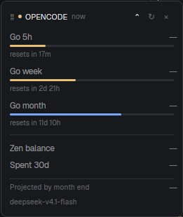

# OpenCode Usage for Herdr

A small floating window that shows your **OpenCode Go** quotas and your **Zen** balance, read straight from the credentials OpenCode already saved.

[](https://github.com/Gentleman-Programming/gentle-ai)



---

## What it shows

| | |
|---|---|
| **Go 5h / week / month** | Three usage bars with the exact reset countdown under each one |
| **Zen balance** | Your prepaid Console balance in dollars |
| **Spent 30d** | Running Console spend for the last 30 days |
| **Projected by month end** | Where your monthly quota lands if you keep this pace |
| **Last model** | The most recent Go model used on this machine |

Bars turn **yellow at 60%** and **red at 85%**. Cross 85% and Herdr sends a native notification once, then stays quiet until the quota resets.

## Install

Tell your coding agent:

```
Read ~/.config/herdr-app/AGENTS.md, then add this mod: https://github.com/AlonsoSG0/herdr-opencode-usage
```

Or by hand:

```sh
git clone https://github.com/AlonsoSG0/herdr-opencode-usage
cp -r herdr-opencode-usage/mods/herdr-opencode-usage ~/.config/herdr-app/mods/
```

Then merge the `keys.json` snippet into your own `~/.config/herdr-app/keys.json`:

```json
{
  "global": { "ctrl-alt-u": "mod.open:herdr-opencode-usage" },
  "mod:herdr-opencode-usage": {
    "ctrl-alt-u": "herdr-opencode-usage.close",
    "escape": "herdr-opencode-usage.close"
  }
}
```

Press `ctrl-alt-u` to open it. With the window focused the same key closes it; `Esc` and `×` always do.

You can also open it from the command palette: `mod.open` → `herdr-opencode-usage`.

## How it works

- **No API keys to paste.** It reads `~/.local/share/opencode/opencode.db` and takes the `opencode-go` and `opencode` credentials that `/connect` and `opencode auth login` already stored. `auth.json` is only a fallback for older installs.
- **Go**: `GET https://opencode.ai/inference/go/v1/usage` with a Bearer token, falling back to `https://opencode.ai/zen/go/v1/usage`.
- **Zen**: `GET https://opencode.ai/console/api/billing/status` and `/console/api/usage/summary?range=30d` with the Console token and the workspace `x-org-id`.
- **Refresh**: on open, then every 5 minutes, with a 45-second floor so opening and refreshing repeatedly never doubles calls. Closing the window stops all timers — no background polling.
- **Model and daily spend** come from the local OpenCode database and cover OpenCode sessions only. If you also work in pi or another client, the model shown may not be the one you are using right then, and daily spend is hidden rather than guessed.

That is roughly 288 reads per day per endpoint, on an API that is cheap to read.

## The window

It is a real Herdr window, not a modal: it does not dim the layout, it stays until you close it, and you can drag it anywhere. Herdr remembers where you dropped it and reopens it there, even after a restart.

Click `⌄` to expand the projection and the last model. The choice is remembered.

## Privacy

The mod reads local credentials and calls `opencode.ai`. It never logs them, never sends them anywhere else, and never writes them to this repository. The screenshot above has every number redacted on purpose.

## Files

```
herdr-opencode-usage/
├── mods/herdr-opencode-usage/
│   ├── main.js        the mod
│   ├── mod.json       window overlay, key and keep
│   └── usage.svg      the three-bar glyph
├── RECIPE.md          the brief to rebuild it from scratch
├── keys.json          the key snippet to merge
└── preview.png
```

`RECIPE.md` is the full brief: what you see, how it behaves, what it is built from, and what to watch out for.

## Requirements

Herdr with the `herdr` mod runtime. `sqlite3` on `PATH` for reading the credential database.

## License

MIT
